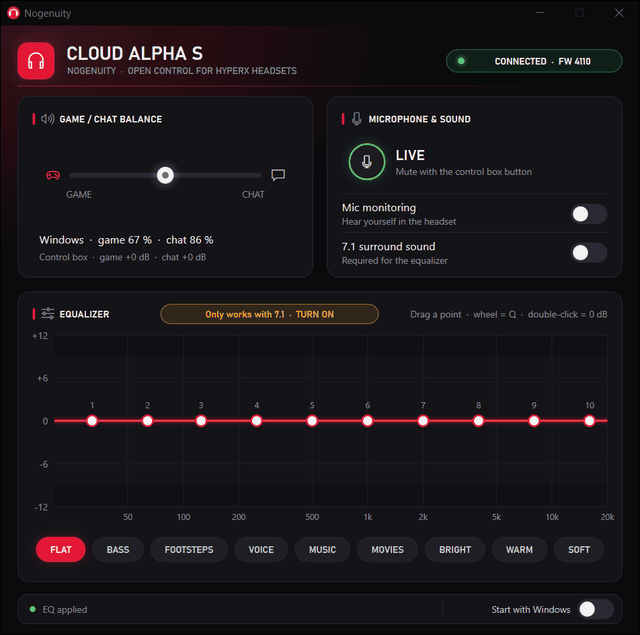

# Nogenuity

**Control libre para auriculares HyperX en Windows y Linux, sin NGENUITY.** Probado con los Cloud Alpha S; [una docena de modelos más](#hardware-compatible) ya están como experimentales, sobre todo los que el nuevo NGENUITY de HyperX deja de soportar.

> Nogenuity es un proyecto independiente de la comunidad, no lo hace ni lo respalda HyperX ni HP. Ver [Aviso legal](#aviso-legal).

[English](README.md)

<p align="center">
  
</p>

- **Se adapta a los cascos que conectes**: reconoce el modelo por su ID USB y enseña solo lo que ese modelo
  puede hacer.
- **Ecualizador**: EQ paramétrico de 10 bandas con la curva de respuesta en directo. Arrastra los puntos,
  usa la rueda para la Q y haz doble clic para volver a 0 dB. Trae 9 presets: Plano, Graves, Pasos, Voz,
  Música, Cine, Brillante, Cálido y Suave.
- Interruptores de **sonido envolvente 7.1** y **mic monitoring** (escucharte en los cascos).
- **Batería y carga** en la cabecera en los inalámbricos, y **CASCOS APAGADOS** cuando solo está el receptor
  USB.
- **Tarjeta del auricular** en los modelos que lo tienen: volumen del mic monitoring, apagado automático y
  avisos de voz.
- **Balance juego / chat** (con el volumen del sistema de las salidas Game y Chat), más el estado en vivo
  de los botones de la caja de control y del mute del micro.
- **Recuerda tu último estado**: lo que dejes encendido o apagado, en la app o con los botones de la caja,
  se restaura al volver a conectar o encender los cascos, junto con tu EQ.
- **Arranca con la sesión** escondida en la bandeja (unos **5 MB de RAM** en Windows). Es un único
  ejecutable pequeño, sin runtime, sin instalador y sin telemetría.
- En español o inglés, según el idioma del sistema.

## Por qué

El nuevo NGENUITY de HyperX solo es compatible con unos pocos auriculares y, según HyperX, la app Legacy
que cubre el resto solo se mantendrá por tiempo limitado. Nogenuity hace que esos auriculares sigan
funcionando, en Windows y en Linux, con una app pequeña que arranca con la sesión y no molesta. Habla
directamente con los cascos, con el protocolo documentado en [docs/PROTOCOL.md](docs/PROTOCOL.md).

## Hardware compatible

| Auricular | ID USB | Windows | Linux | Funciones |
|---|---|:-:|:-:|---|
| HyperX Cloud Alpha S (con cable, caja de control USB) | `0951:16ED` | ✔ | ✔ | 7.1, EQ, mic monitoring, balance juego/chat, estado del micro; probado con el firmware `0x4110` |
| HyperX Cloud Alpha S, ID de la época HP | `03F0:0C91` | — | — | El mismo protocolo que el de arriba |
| HyperX Cloud Flight S | `0951:16EA` | — | — | 7.1, EQ, mic monitoring, batería y carga |
| HyperX Cloud II Wireless | `0951:1718`, `03F0:0C8A` | — | — | 7.1, EQ, mic monitoring, estado del micro, batería y carga |
| HyperX Cloud Alpha Wireless | `0951:1743`, `0951:1765`, `03F0:098D` | — | — | Batería y carga, estado del micro, mic monitoring y su volumen, apagado automático, avisos de voz, cascos apagados |
| HyperX Cloud II Wireless DTS | `03F0:018B`, `03F0:0696`, `03F0:038B`, `03F0:058B` | — | — | Batería y carga, estado del micro, mic monitoring, apagado automático, cascos apagados |
| HyperX Cloud Flight Wireless | `0951:16C4`, `0951:1723`, `03F0:0E90` | — | — | Batería y carga, cascos apagados |
| HyperX Cloud Stinger Core Wireless | `0951:170B` | — | ⚠️ | Batería y carga, cascos apagados |
| HyperX Cloud III Wireless | `03F0:0C9D`, `03F0:05B7`, `03F0:0E9D`, `03F0:06B7` | — | — | Batería y carga, estado del micro, mic monitoring y su volumen, apagado automático, cascos apagados |
| HyperX Cloud II Core Wireless | `03F0:0995`, `03F0:069F` | — | — | Batería y carga, estado del micro, mic monitoring y su volumen, apagado automático, cascos apagados |
| HyperX Cloud Stinger 2 Wireless | `03F0:0D93` | — | — | Batería y carga, mic monitoring, apagado automático, cascos apagados |
| HyperX Cloud III (con cable) | `03F0:089D`, `03F0:03CC`, `03F0:0ACE` | — | — | Mic monitoring y su nivel |

- ✔ Confirmado con unos cascos de verdad en ese sistema.
- ⚠️ Funciona, con una limitación conocida. En la Cloud Stinger Core Wireless el porcentaje de batería es
  aproximado, y poco fiable mientras carga.
- — Implementado, pero aún sin probar en ese sistema.

La app muestra la etiqueta **EXPERIMENTAL** en los modelos que no están del todo confirmados, en los dos
sistemas. Si tienes uno, [ayuda a probarlo](CONTRIBUTING.md#testing-a-headset): esos modelos tienen un enlace
**Enviar informe** que hace casi todo. **Vienen más modelos**: mira el
[catálogo de compatibilidad](docs/DEVICES.md).

| Sistema | Estado |
|---|---|
| Windows 10 / 11, x64 | Probado en Windows 11 |
| Linux, x86-64 (X11 o Wayland), glibc 2.31+ (Ubuntu 20.04, Debian 11 y posteriores) | Probado con los cascos de verdad en Ubuntu 26.04 (PipeWire) y Ubuntu 24.04 (WSL2 + usbipd, sin balance) |
| Fedora 44 y posteriores, `.rpm` | Experimental: la CI instala y desinstala el paquete, aún sin probar con cascos de verdad |
| Linux, ARM64 (`aarch64`), glibc 2.31+ | Experimental: la CI lo compila y pasa los tests, aún sin probar con cascos de verdad |

## Instalación en Windows

1. Descarga `Nogenuity.exe` desde [Releases](../../releases) (o compílalo, abajo).
2. Ponlo en la carpeta que quieras y ejecútalo. En el primer arranque se registra para iniciarse con
   Windows; puedes desactivarlo desde la ventana.
3. **Cierra o desinstala NGENUITY.** Si dos programas hablan con la caja de control a la vez, se estorban.

Haz clic en el icono de la bandeja para abrir la ventana. Al cerrar la ventana la app sigue en la
bandeja; para salir, clic derecho en el icono → *Salir*.

## Instalación en Linux

**Ubuntu, Debian, Linux Mint, Pop!_OS:** descarga `nogenuity_<versión>-1_amd64.deb` (`arm64` en ARM) desde
[Releases](../../releases) e instálalo con `sudo apt install ./nogenuity_*.deb`. Nada más: añade la entrada del
menú y la regla udev, y los cascos funcionan sin desenchufarlos. `sudo apt remove nogenuity` lo quita.
Si antes instalaste el tarball con `install.sh`, ejecuta primero su `uninstall.sh`; si no, el menú seguirá abriendo esa copia.

**Fedora (experimental):** descarga `nogenuity-<versión>-1.x86_64.rpm` (`aarch64` en ARM) desde
[Releases](../../releases) e instálalo con `sudo dnf install ./nogenuity-*.rpm`. Hace lo mismo que el `.deb`, y
`sudo dnf remove nogenuity` lo quita. Vale la misma nota sobre `uninstall.sh`. No se actualiza solo: instala la versión
nueva de la misma forma. En Bazzite, Silverblue y otras variantes atómicas, usa el AppImage.

**Cualquier otra distribución** (tarball):

1. Descarga `nogenuity-<versión>-linux-x86_64.tar.gz` (`aarch64` en ARM) desde [Releases](../../releases) y descomprímelo.
2. Ejecuta `./install.sh` desde esa carpeta. Instala Nogenuity para tu usuario (sin root): `~/.local/bin/nogenuity`,
   la entrada del menú de aplicaciones y los iconos. Después ofrece instalar la regla udev que deja a tu
   usuario hablar con los cascos; esa parte pide tu contraseña una vez. `./uninstall.sh` lo quita todo.
3. Abre **Nogenuity** desde el menú de aplicaciones. En el primer arranque se añade a `~/.config/autostart`
   (puedes desactivarlo desde la ventana).

Sin el instalador: ejecuta `./nogenuity` desde la carpeta e instala la regla udev a mano:
```
sudo install -m 0644 70-nogenuity.rules /etc/udev/rules.d/
sudo mkdir -p /etc/alsa-card-profile && sudo cp -R alsa-card-profile /etc/alsa-card-profile/mixer
sudo udevadm control --reload-rules && sudo udevadm trigger --subsystem-match=hidraw --action=change
```
Si falta la regla, la app lo avisa en su barra de estado.

El icono de la bandeja usa StatusNotifierItem: funciona directamente en KDE Plasma y la mayoría de
escritorios; en GNOME necesita la extensión *AppIndicator*. Sin bandeja, volver a abrir la app muestra la
ventana. El balance usa `pactl` (PipeWire o PulseAudio), del paquete `pulseaudio-utils` en Debian, Ubuntu y Fedora.

Cada release incluye un archivo `SHA256SUMS`. Para comprobar una descarga: `sha256sum -c --ignore-missing SHA256SUMS`.

## Balance juego/chat en Linux

El balance necesita dos salidas, Game y Chat. Con PipeWire, un Cloud Alpha S solo tiene una por defecto, así que el
`.deb`, el `.rpm`, `install.sh` y el botón **Grant access** instalan también un perfil de PipeWire para estos cascos. Se aplica
la próxima vez que los conectes. Esto cambia cómo configura el sistema su audio: en los ajustes de sonido aparecen
entonces dos salidas, Game y Chat.

Para comprobarlo, `pactl list sinks short` debe mostrar `stereo-game-output` y `stereo-chat-output`.

- **Probado en:** Ubuntu 26.04 con PipeWire 1.6.2 y un Cloud Alpha S real: balance, desconexión, micrófono, 7.1 y EQ.
  No se ha probado en otras distribuciones ni en versiones anteriores de PipeWire, y PulseAudio sin PipeWire no
  lee este perfil.
- **Si diste permiso con una versión anterior:** ejecuta de nuevo `./install.sh` o instala el `.deb`.
- **Para quitarlo** (el `.deb` y el `.rpm` quitan sus propios archivos al desinstalarlos):
  ```
  sudo rm /etc/udev/rules.d/70-nogenuity.rules
  sudo rm /etc/alsa-card-profile/mixer/paths/nogenuity-alpha-s-game.conf
  sudo rm /etc/alsa-card-profile/mixer/paths/nogenuity-alpha-s-chat.conf
  sudo rm /etc/alsa-card-profile/mixer/profile-sets/nogenuity-alpha-s.conf
  sudo udevadm control --reload-rules
  ```
  Después vuelve a conectar los cascos. La primera línea también quita el acceso a los cascos: sin ella, la app
  vuelve a mostrar el botón **Grant access**.

## Compilar

Necesita Rust 1.99 o posterior.

```
cargo build --release
```

- **Windows** (toolchain MSVC): `target/release/nogenuity.exe`.
- **Linux**: `target/release/nogenuity`. Necesita los paquetes de desarrollo gráficos habituales, por ejemplo en
  Debian/Ubuntu: `sudo apt install build-essential pkg-config libfontconfig1-dev libxkbcommon-dev libwayland-dev`.
- **Binario Linux de la release** (funciona con glibc 2.31 o posterior), como lo hace la CI: instala [Zig](https://ziglang.org) y
  `cargo install cargo-zigbuild`, y luego `cargo zigbuild --release --target x86_64-unknown-linux-gnu.2.31`.
  `packaging/linux/package.sh <binario> <versión> <carpeta>` crea el tarball.

## Notas

- El EQ solo funciona con el **7.1 encendido**, porque va dentro del DSP del envolvente. La app te lo
  recuerda.
- Los ajustes y registros (`settings.txt`, `hid.log`, `crash.log`) están en `%APPDATA%\Nogenuity` en
  Windows y en `~/.config/nogenuity` en Linux.
- Si la caja de control deja de responder, la app la recupera sola (ver
  [docs/PROTOCOL.md](docs/PROTOCOL.md#the-box-blocks-while-a-reply-is-unread)); no hace falta desenchufarla.

## Relacionado

El soporte básico de este auricular (sidetone, chatmix y estado del mute) también se ha enviado a
[HeadsetControl](https://github.com/Sapd/HeadsetControl/pull/612), una herramienta de línea de comandos que
funciona además en Linux y macOS.

## Licencia

[GPL-3.0](LICENSE). Nogenuity no tiene ninguna garantía, como dice la licencia.

## Aviso legal

- **Proyecto independiente.** Nogenuity no está afiliado, autorizado, respaldado ni patrocinado por HP Inc.,
  HyperX ni Kingston Technology. No es software oficial de HyperX y su soporte técnico no puede ayudarte
  con él: [abre un issue](../../issues) aquí.
- **Marcas.** HyperX, Cloud, Cloud Alpha, NGENUITY y los demás nombres de productos son marcas de sus
  respectivos dueños. Solo se usan para indicar con qué hardware funciona Nogenuity.
- **Sin código del fabricante.** Nogenuity no contiene código, firmware, imágenes ni otros archivos del
  software de HyperX. Habla con los cascos por USB HID estándar, para la interoperabilidad, y
  [docs/PROTOCOL.md](docs/PROTOCOL.md) solo describe cómo se comporta el dispositivo.
- **Seguro por diseño.** Nogenuity nunca actualiza ni escribe firmware, y solo cambia los ajustes que ves en
  su ventana. Los modelos experimentales aún no están confirmados con hardware real; los usas bajo tu
  responsabilidad.
- **Titulares de derechos:** si tienes alguna objeción sobre este proyecto, contacta con el mantenedor a
  través de [GitHub](https://github.com/esdedev) y se atenderá cuanto antes.
