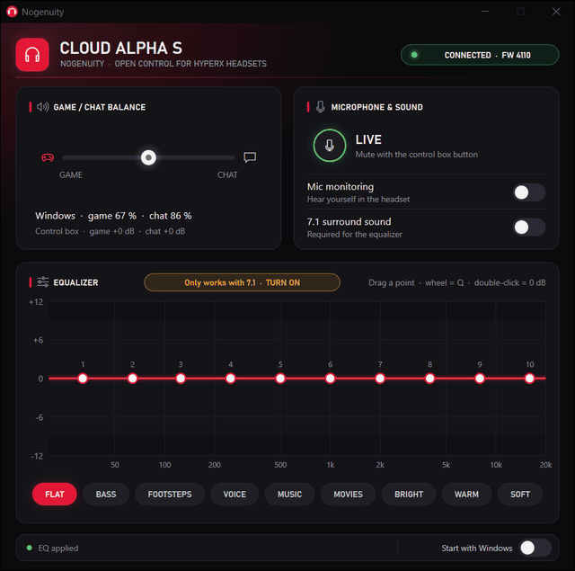

# Nogenuity

**Open control for HyperX headsets on Windows and Linux — no NGENUITY needed.** Tested on the Cloud Alpha S; [a dozen more models](#supported-hardware) are in as experimental, especially the ones HyperX's new NGENUITY no longer supports.

> Nogenuity is an independent community project, not made or endorsed by HyperX or HP. See [Disclaimer](#disclaimer).

[Español](README.es.md)

<p align="center">
  
</p>

- **Adapts to the headset you plug in**: it finds the model by its USB ID and shows only what that model
  can do.
- **Equalizer** — 10-band parametric EQ with a live response curve: drag points, mouse wheel for Q,
  double-click for 0 dB. Comes with 9 presets: Flat, Bass, Footsteps, Voice, Music, Movies, Bright, Warm
  and Soft.
- **7.1 surround** and **mic monitoring** (sidetone) switches.
- **Battery and charging** in the header on wireless models, and **HEADSET OFF** when only the USB dongle
  is there.
- **Headset card** where the model has them: mic monitoring level, auto power-off and voice prompts.
- **Game / chat balance** slider (through the system volume of the Game and Chat outputs), plus the
  live state of the control box buttons and the microphone mute.
- **Remembers your last state**: whatever you leave on or off (in the app or with the box buttons) is
  restored when the headset is plugged in or switched on again, together with your EQ.
- **Starts with your session** hidden in the tray (about **5 MB of RAM** on Windows), a single small
  binary, no runtime, no installer, no telemetry.
- English or Spanish, following the system language.

## Why

HyperX's new NGENUITY supports only a handful of headsets, and according to HyperX the Legacy app that
covers the rest will only be maintained for a limited time. Nogenuity keeps those headsets working, on
Windows and on Linux, with a small app that starts with your session and stays out of the way. It talks to
the headset directly, using the protocol documented in [docs/PROTOCOL.md](docs/PROTOCOL.md).

## Supported hardware

| Headset | USB ID | Windows | Linux | Features |
|---|---|:-:|:-:|---|
| HyperX Cloud Alpha S (wired, USB control box) | `0951:16ED` | ✔ | ✔ | 7.1, EQ, mic monitoring, game/chat balance, mic mute status; tested on firmware `0x4110` |
| HyperX Cloud Alpha S, HP-era ID | `03F0:0C91` | — | — | Same protocol as the one above |
| HyperX Cloud Flight S | `0951:16EA` | — | — | 7.1, EQ, mic monitoring, battery and charging |
| HyperX Cloud II Wireless | `0951:1718`, `03F0:0C8A` | — | — | 7.1, EQ, mic monitoring, mute status, battery and charging |
| HyperX Cloud Alpha Wireless | `0951:1743`, `0951:1765`, `03F0:098D` | — | — | Battery and charging, mic mute status, mic monitoring and its level, auto power-off, voice prompts, headset off |
| HyperX Cloud II Wireless DTS | `03F0:018B`, `03F0:0696`, `03F0:038B`, `03F0:058B` | — | — | Battery and charging, mic mute status, mic monitoring, auto power-off, headset off |
| HyperX Cloud Flight Wireless | `0951:16C4`, `0951:1723`, `03F0:0E90` | — | — | Battery and charging, headset off |
| HyperX Cloud Stinger Core Wireless | `0951:170B` | — | ⚠️ | Battery and charging, headset off |
| HyperX Cloud III Wireless | `03F0:0C9D`, `03F0:05B7`, `03F0:0E9D`, `03F0:06B7` | — | — | Battery and charging, mic mute status, mic monitoring and its level, auto power-off, headset off |
| HyperX Cloud II Core Wireless | `03F0:0995`, `03F0:069F` | — | — | Battery and charging, mic mute status, mic monitoring and its level, auto power-off, headset off |
| HyperX Cloud Stinger 2 Wireless | `03F0:0D93` | — | — | Battery and charging, mic monitoring, auto power-off, headset off |
| HyperX Cloud III (wired) | `03F0:089D`, `03F0:03CC`, `03F0:0ACE` | — | — | Mic monitoring and its level |

- ✔ Confirmed with a real headset on that system.
- ⚠️ Works, with a known limitation. On the Cloud Stinger Core Wireless the battery percentage is approximate,
  and unreliable while charging.
- — Implemented, but not tried yet on that system.

The app shows an **EXPERIMENTAL** badge on any model that isn't fully confirmed, on both systems. If you own
one, [help test it](CONTRIBUTING.md#testing-a-headset): those models have a **Send report** link that does most
of the work. **More models are on the way** — see the [support catalog](docs/DEVICES.md).

| System | Status |
|---|---|
| Windows 10 / 11, x64 | Tested on Windows 11 |
| Linux, x86-64 (X11 or Wayland), glibc 2.31+ (Ubuntu 20.04, Debian 11 and newer) | Tested on Ubuntu 26.04 (PipeWire) and Ubuntu 24.04 (WSL2 + usbipd, no balance) with the real headset |
| Fedora 44 and newer, `.rpm` | Experimental: CI installs and removes the package, not yet tried with a real headset |
| Linux, ARM64 (`aarch64`), glibc 2.31+ | Experimental: CI builds it and runs the tests, not yet tried with a real headset |

## Install — Windows

1. Download `Nogenuity.exe` from the [Releases](../../releases) page (or build it, below).
2. Put it in a folder of your choice and run it. On first run it registers itself to start with Windows
   (you can turn that off from the window).
3. **Close or uninstall NGENUITY.** Two programs talking to the control box at the same time get in each
   other's way.

Click the tray icon to open the window; closing the window keeps it running in the tray. Right-click the
tray icon → *Exit* to quit.

## Install — Linux

**Ubuntu, Debian, Linux Mint, Pop!_OS:** download `nogenuity_<version>-1_amd64.deb` (`arm64` on ARM) from
[Releases](../../releases) and install it with `sudo apt install ./nogenuity_*.deb`. That's all: it adds the
menu entry and the udev rule, and the headset works without unplugging it. `sudo apt remove nogenuity` removes it.
If you installed the tarball with `install.sh` before, run its `uninstall.sh` first, or the menu keeps opening that copy.

**Fedora (experimental):** download `nogenuity-<version>-1.x86_64.rpm` (`aarch64` on ARM) from
[Releases](../../releases) and install it with `sudo dnf install ./nogenuity-*.rpm`. It does the same as the `.deb`,
and `sudo dnf remove nogenuity` removes it. The same note about `uninstall.sh` applies. It doesn't update on its own:
install the new version the same way. On Bazzite, Silverblue and other atomic variants, use the AppImage.

**Any other distribution** (tarball):

1. Download `nogenuity-<version>-linux-x86_64.tar.gz` (`aarch64` on ARM) from [Releases](../../releases) and unpack it.
2. Run `./install.sh` from that folder. It installs Nogenuity for your user (no root): `~/.local/bin/nogenuity`,
   the application menu entry and the icons. It then offers to install the udev rule that lets your user
   talk to the headset; that part needs your password once. `./uninstall.sh` removes everything again.
3. Open **Nogenuity** from the application menu. On first run it adds itself to `~/.config/autostart` (you can
   turn that off from the window).

Without the installer: run `./nogenuity` from the folder, and install the udev rule by hand:
```
sudo install -m 0644 70-nogenuity.rules /etc/udev/rules.d/
sudo mkdir -p /etc/alsa-card-profile && sudo cp -R alsa-card-profile /etc/alsa-card-profile/mixer
sudo udevadm control --reload-rules && sudo udevadm trigger --subsystem-match=hidraw --action=change
```
If the rule is missing, the app says so in its status bar.

The tray icon uses StatusNotifierItem: it works out of the box on KDE Plasma and most desktops; on GNOME
it needs the *AppIndicator* extension. Without a tray, running the app again shows the window. The balance
slider uses `pactl` (PipeWire or PulseAudio), from the `pulseaudio-utils` package on Debian, Ubuntu and Fedora.

Each release includes a `SHA256SUMS` file. To check a download: `sha256sum -c --ignore-missing SHA256SUMS`.

## Game/chat balance on Linux

The balance needs two outputs, Game and Chat. On PipeWire a Cloud Alpha S only gets one by default, so the
`.deb`, the `.rpm`, `install.sh` and the **Grant access** button also install a PipeWire profile for this headset. It takes
effect the next time you plug the headset in. This changes how your system sets up its audio: in the sound
settings it then appears as two outputs, Game and Chat.

To check it, `pactl list sinks short` should list `stereo-game-output` and `stereo-chat-output`.

- **Tested on:** Ubuntu 26.04 with PipeWire 1.6.2 and a real Cloud Alpha S: balance, unplugging, mic, 7.1 and EQ.
  Other distributions and older PipeWire versions haven't been tried, and PulseAudio without PipeWire doesn't
  read this profile.
- **If you granted access with an earlier version:** run `./install.sh` again, or install the `.deb`.
- **To remove it** (the `.deb` and the `.rpm` remove their own files when you uninstall them):
  ```
  sudo rm /etc/udev/rules.d/70-nogenuity.rules
  sudo rm /etc/alsa-card-profile/mixer/paths/nogenuity-alpha-s-game.conf
  sudo rm /etc/alsa-card-profile/mixer/paths/nogenuity-alpha-s-chat.conf
  sudo rm /etc/alsa-card-profile/mixer/profile-sets/nogenuity-alpha-s.conf
  sudo udevadm control --reload-rules
  ```
  Then plug the headset back in. The first line also removes access to the headset: without it, the app shows
  the **Grant access** button again.

## Build

Requires Rust 1.99 or later.

```
cargo build --release
```

- **Windows** (MSVC toolchain): `target/release/nogenuity.exe`.
- **Linux**: `target/release/nogenuity`. Needs the usual graphics development packages, e.g. on Debian/Ubuntu:
  `sudo apt install build-essential pkg-config libfontconfig1-dev libxkbcommon-dev libwayland-dev`.
- **Linux release binary** (runs on glibc 2.31 and newer), as the CI does it: install [Zig](https://ziglang.org) and
  `cargo install cargo-zigbuild`, then `cargo zigbuild --release --target x86_64-unknown-linux-gnu.2.31`.
  `packaging/linux/package.sh <binary> <version> <dir>` makes the tarball.

## Notes

- The EQ only works while **7.1 is on** (it runs inside the surround DSP); the app reminds you.
- Settings and logs (`settings.txt`, `hid.log`, `crash.log`) live in `%APPDATA%\Nogenuity` on Windows
  and `~/.config/nogenuity` on Linux.
- If the control box ever stops answering, the app recovers it on its own (see
  [docs/PROTOCOL.md](docs/PROTOCOL.md#the-box-blocks-while-a-reply-is-unread)); no need to unplug it.

## Related

Basic support for this headset (sidetone, chat-mix and mic mute status) was also contributed to
[HeadsetControl](https://github.com/Sapd/HeadsetControl/pull/612), a command-line tool that works on
Linux and macOS too.

## License

[GPL-3.0](LICENSE). Nogenuity comes with no warranty, as the license says.

## Disclaimer

- **Independent project.** Nogenuity is not affiliated with, authorized, endorsed or sponsored by HP Inc.,
  HyperX or Kingston Technology. It is not official HyperX software, and HyperX support can't help with it:
  please [open an issue](../../issues) here instead.
- **Trademarks.** HyperX, Cloud, Cloud Alpha, NGENUITY and the other product names are trademarks of their
  respective owners. They are used only to say which hardware Nogenuity works with.
- **No vendor code.** Nogenuity contains no code, firmware, images or other files from HyperX software. It
  talks to the headset over standard USB HID, for interoperability, and [docs/PROTOCOL.md](docs/PROTOCOL.md)
  describes only how the device behaves.
- **Safe by design.** Nogenuity never updates or writes firmware, and only changes the settings you see in
  its window. Experimental models are not yet confirmed on real hardware; you use them at your own risk.
- **Rights holders:** if you have a concern about this project, please contact the maintainer through
  [GitHub](https://github.com/esdedev) and it will be addressed promptly.
